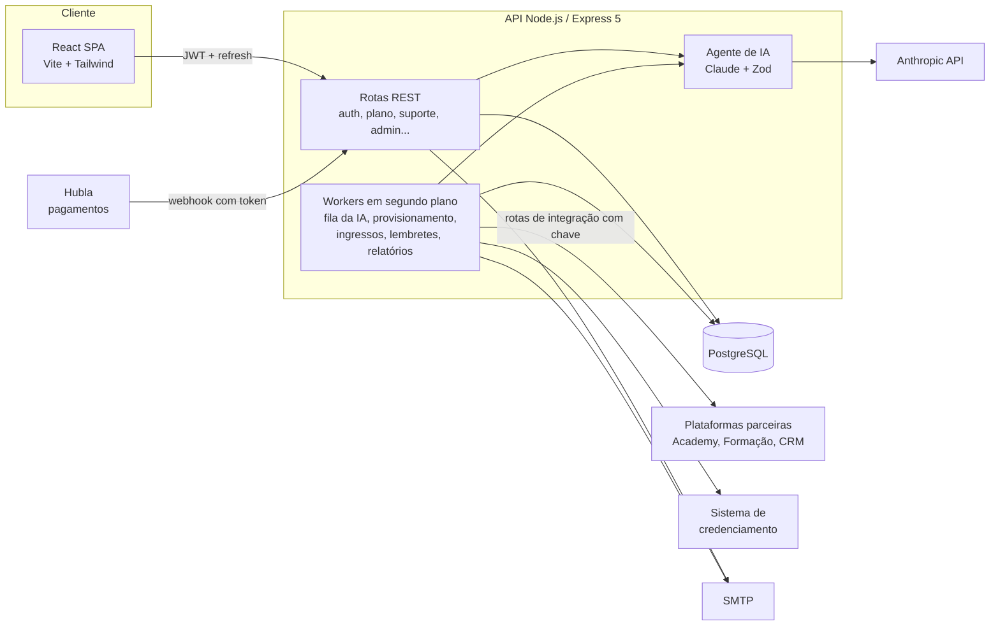

# Gestão 360° — plataforma de gestão empresarial com IA

Plataforma web completa para um programa de gestão por assinatura voltado a donos de pequenas e médias empresas. O cliente responde uma **anamnese** sobre o negócio, um **agente de IA (Claude)** escreve o rascunho do **Diagnóstico 360°** e do **Plano de Ação**, a equipe revisa e publica, e o cliente executa o plano com atividades práticas, check-ins mensais e um **chat de suporte com IA** que passa a conversa para um humano quando precisa.

Por trás disso há um painel administrativo completo, integração de pagamentos por webhook, provisionamento automático de acesso em plataformas parceiras, ingressos com QR code para eventos presenciais, e-mails transacionais com rastreio de abertura e controle de custo da IA.

> **Sobre esta versão.** Este repositório é uma versão **anonimizada** de um sistema real que desenvolvi para uma empresa. Nome, marca, domínios, metodologia, prompts, base de conhecimento, textos legais, preços e dados de clientes foram trocados por conteúdo fictício. A arquitetura, as regras de negócio e o código são os do sistema real.

**English summary:** Full-stack subscription platform (React 19 + TypeScript + Vite / Node.js + Express 5 + PostgreSQL) for a business-management program. An AI agent (Anthropic Claude, structured outputs validated with Zod, prompt caching) drafts each client's diagnosis and action plan from a scored questionnaire. The team reviews and publishes it in an admin panel. Also includes an AI support chat with human handoff, payment webhooks (Hubla), background provisioning queues for partner platforms, QR-code event tickets, transactional e-mail with open tracking, role-based admin permissions and AI cost tracking. Runs locally with one `docker compose up`.

---

## Sumário

- [O que a plataforma faz](#o-que-a-plataforma-faz)
- [Arquitetura](#arquitetura)
- [Stack](#stack)
- [Rodar localmente](#rodar-localmente)
- [Contas de demonstração](#contas-de-demonstração)
- [Roteiro para testar](#roteiro-para-testar)
- [Integrações](#integrações)
- [O agente de IA](#o-agente-de-ia)
- [Segurança](#segurança)
- [Estrutura do repositório](#estrutura-do-repositório)
- [Variáveis de ambiente](#variáveis-de-ambiente)
- [Decisões técnicas](#decisões-técnicas)

---

## O que a plataforma faz

### Área do cliente

| Módulo | O que faz |
|---|---|
| **Primeiro acesso** | Não existe cadastro aberto: o acesso nasce da compra (webhook) ou do cadastro pela equipe. O cliente recebe um link de uso único para criar a senha. |
| **Anamnese** | Questionário de cerca de 35 perguntas em blocos (financeiro, vendas, marketing, processos, pessoas, tecnologia, execução). Inclui indicadores numéricos (faturamento, margem), cidade/UF com a lista do IBGE e rascunho salvo automaticamente. Cada resposta pontua de 0 a 3 por pilar, e a pontuação nunca chega ao cliente. |
| **Diagnóstico 360° e Plano de Ação** | Documento gerado pela IA e revisado pela equipe: estágio de maturidade por pilar, a prioridade e o motivo dela, até 3 ações ativas com passos, indicadores e conteúdos recomendados. O cliente define o responsável e o prazo de cada ação, marca o progresso e pode imprimir ou salvar em PDF. |
| **Atividades práticas** | Exercícios semanais ligados ao plano, com progresso por cliente. |
| **Check-in mensal** | Três perguntas rápidas e uma devolutiva curta. |
| **Agenda e eventos** | Treinamentos ao vivo, encontros mensais e eventos presenciais. Eventos com ingresso geram QR code individual. |
| **Chat de suporte com IA** | Responde com base na base de conhecimento. Classifica o assunto (dúvida, problema técnico, pedido sensível) e, quando é o caso, coloca o cliente na fila de atendimento humano. A equipe assume a conversa pelo painel. |
| **Catálogo de entregáveis** | Cards por plano (Essencial e Premium). Os entregáveis internos abrem telas da plataforma e os externos abrem as plataformas parceiras. Quem está no Essencial vê o modal de upgrade. |
| **Agendamento de integração** | O cliente escolhe dia e horário (configuráveis no painel) para uma chamada de onboarding. A confirmação, o link da chamada e a remarcação chegam por e-mail. |

### Painel administrativo (`/adm`)

- **Visão geral:** números do programa, fila de revisão e alertas.
- **Alunos:** busca, cadastro manual, detalhe completo (assinatura, histórico de e-mails com abertura, acessos externos, ingressos), reenvio de acesso, liga/desliga integrações por aluno.
- **Editor de plano:** edita o rascunho da IA campo a campo, valida as regras obrigatórias antes de publicar e mostra a pré-visualização igual à do cliente. Também pede uma nova geração com orientação da equipe.
- **Atendimentos:** fila do suporte humano, assumir e devolver conversas.
- **Base de conhecimento:** artigos que alimentam o chat. Aceita importar texto de PDF e DOCX direto no navegador (pdf.js e mammoth).
- **Relatório do suporte:** análise semanal das conversas feita pela IA, com perguntas frequentes, lacunas na base e sugestões de artigo.
- **Custo da IA:** tokens e custo por mês e por uso (plano, suporte, relatório), incluindo leitura e escrita de cache.
- **Eventos e ingressos:** cria eventos, emite ingressos e confere QR code na entrada.
- **Equipe e permissões:** papel *master* e administradores com acesso por área.
- **Hubla:** histórico de todos os webhooks recebidos e do que cada um causou.
- **Configurações:** horários de agendamento, e-mail de alertas, padrões para novos clientes, pixels de rastreamento.

---

## Arquitetura



**Fluxo principal**

1. A compra na Hubla dispara um webhook. A API confere o token, registra o aviso, cria ou reativa o cliente, define o plano pela oferta e envia o e-mail de acesso.
2. Um worker cria os acessos nas plataformas parceiras, com nova tentativa automática se uma delas estiver fora do ar.
3. O cliente cria a senha e responde a anamnese. O envio entra na fila do agente.
4. O agente gera o rascunho estruturado (validado por schema). A fila sobrevive a reinícios: rascunhos interrompidos são retomados quando a API sobe.
5. A equipe revisa no editor e publica. O cliente recebe o diagnóstico e o plano.
6. Cancelamento ou reembolso chega por webhook e corta o acesso, inclusive nas plataformas parceiras.

---

## Stack

**Frontend:** React 19, TypeScript 5.9, Vite 7, Tailwind CSS 4, TanStack Query, Zustand, Axios, Lucide, qrcode, pdf.js, mammoth. Roteamento próprio e leve, tema claro e escuro, layout de impressão para plano e ingresso.

**Backend:** Node.js 22, Express 5, PostgreSQL (`pg`), Zod 4, `@anthropic-ai/sdk`, JWT (access + refresh com sessão no banco), bcrypt, Helmet, express-rate-limit, Nodemailer.

**Infra:** Dockerfiles multi-stage (a imagem da API roda sem root) e `docker-compose` para o ambiente local. Em produção roda numa VPS com Nginx e deploy por GitHub Actions; essa parte foi retirada deste repositório.

---

## Rodar localmente

### Opção 1: Docker (recomendado)

Pré-requisito: Docker Desktop.

```bash
git clone https://github.com/vitormouramaker/gestao-360-platform.git
cd gestao-360-platform
docker compose up --build
```

- Front: http://localhost:5180
- API: http://localhost:4460/api/health

Na subida, o compose cria o banco e as tabelas, as [contas de demonstração](#contas-de-demonstração) e a base de conhecimento.

Para ligar a IA (opcional), exporte a chave antes de subir:

```bash
ANTHROPIC_API_KEY=sk-ant-... docker compose up --build
```

### Opção 2: Sem Docker

Pré-requisitos: Node.js 22+ e PostgreSQL 14+ rodando localmente.

```bash
# 1. API
cd backend
cp .env.example .env          # ajuste DB_USER / DB_PASSWORD / DB_PORT se precisar
npm install
npm run db:init               # cria o banco gestao_360 e as tabelas
npm run seed:demo             # contas de demonstração (senha Demo@360)
npm run kb:load               # base de conhecimento do chat
npm run dev                   # http://localhost:4460

# 2. Front (outro terminal)
cd frontend
npm install
npm run dev                   # http://localhost:5180
```

O front encontra a API local sozinho (consulta `/api/health` nas portas conhecidas). Para apontar para outra API, use `VITE_API_ORIGIN` em `frontend/.env.local`.

### Sem chaves externas, tudo funciona

| Sem... | Comportamento |
|---|---|
| `ANTHROPIC_API_KEY` | A plataforma funciona normalmente. A equipe escreve o plano no editor, e o chat avisa que não conseguiu responder e oferece falar com a equipe (atendimento humano). |
| SMTP | Nenhum e-mail sai da máquina. O assunto e os links (criar senha, recuperar senha) aparecem no console da API. |
| Hubla | O webhook recusa tudo. Clientes são cadastrados pelo painel ou pelo seed. |
| Plataformas parceiras / credenciamento | Os acessos ficam "na fila" e a conferência de ingressos é feita pelo próprio `/adm`. |

---

## Contas de demonstração

Criadas por `npm run seed:demo` (ou automaticamente no Docker). Senha de todas: **`Demo@360`**. As contas existem só no seu banco local.

| Perfil | E-mail | Onde entrar |
|---|---|---|
| Cliente plano Essencial | `essencial@demo.gestao360.test` | http://localhost:5180 |
| Cliente plano Premium | `premium@demo.gestao360.test` | http://localhost:5180 |
| Administrador (master) | `admin@demo.gestao360.test` | http://localhost:5180/adm |

## Roteiro para testar

1. Entre como **premium** e responda a anamnese.
2. Abra o painel `/adm` como **admin** em outra janela anônima. O diagnóstico aparece na fila de revisão.
   - Com `ANTHROPIC_API_KEY`, o rascunho da IA chega em alguns segundos.
   - Sem a chave, preencha o plano no editor.
3. Publique o plano e volte à conta do cliente para ver o Diagnóstico 360° e o Plano de Ação. Defina responsáveis e prazos e teste a impressão.
4. Abra o chat de suporte e faça perguntas sobre o programa. Peça para falar com um atendente e assuma a conversa no painel, em Atendimentos.
5. Entre como **essencial** para ver o catálogo limitado e o modal de upgrade.
6. Em "Esqueceu a senha?", o link de redefinição aparece no console da API.

---

## Integrações

### Hubla (pagamentos)
- Endpoint `POST /api/hubla/webhook`, autenticado pelo cabeçalho `x-hubla-token` com comparação em tempo constante.
- Eventos de liberação (`customer.member_added`, `subscription.activated`, `invoice.payment_succeeded`) e de corte (assinatura desativada, reembolso). O plano sai do id da oferta.
- Todo aviso fica gravado com o que causou, inclusive testes do painel. A leitura do payload tolera variações de formato.
- A data de renovação é calculada a partir dos avisos e alimenta o lembrete por e-mail 3 dias antes.

### Plataformas parceiras (Academy, Formação Executiva, CRM)
- Cada plataforma expõe rotas de integração protegidas por uma chave que só a API conhece.
- Provisionamento em fila com nova tentativa: criar, renovar, bloquear e reativar. Existe um período de tolerância para não cortar o acesso enquanto o pagamento do novo ciclo é confirmado.
- Liga/desliga global e por aluno. Clientes antigos mantêm a integração (*grandfathering*) quando ela é desligada para novos.

### Credenciamento de eventos
- Ingressos com QR code, sincronizados com um sistema externo de leitura na portaria, com fallback de conferência pelo próprio painel.
- Janela de elegibilidade por data de assinatura e bônus para os N primeiros assinantes.
- Excluir um evento cancela os ingressos no sistema externo antes de apagar, para não deixar ingressos válidos órfãos.

### E-mail
- Templates transacionais: acesso, boas-vindas, recuperação de senha, renovação, ingresso, agendamento.
- Registro de cada envio por aluno, com pixel de abertura e reenvio manual pelo painel.

---

## O agente de IA

Implementado em [`backend/src/services/agent.service.js`](backend/src/services/agent.service.js).

- **Saída estruturada:** o plano, a resposta do suporte e o relatório semanal são gerados com `betaZodOutputFormat`, com schemas Zod que limitam campos, enums de conteúdos permitidos e quantidades (por exemplo, no máximo 3 ações ativas). Depois disso, o plano ainda passa por validações de negócio antes de poder ser publicado.
- **Prompt caching:** a parte fixa das instruções (prompt mestre, metodologia, padrões de intervenção, arquitetura do documento) vai num bloco com `cache_control`. Gerações seguidas pagam só a parte variável.
- **Esforço por tarefa:** `effort` alto para o plano, baixo para o chat e médio para o relatório.
- **Contexto calculado:** a maturidade por pilar é calculada em código a partir da pontuação da anamnese, com regras de teto. A IA recebe o estágio já calculado e não inventa nota.
- **Humano no circuito:** todo plano passa por revisão. A equipe pode pedir nova geração com orientação própria. O suporte classifica pedidos sensíveis e passa a conversa para um humano.
- **Fila resiliente:** rascunhos pendentes são retomados quando a API reinicia.
- **Custo:** cada chamada grava tokens de entrada, saída e cache, e o painel mostra o custo por mês e por tipo de uso.
- **Base de conhecimento editável:** artigos no banco, editados no painel, injetados no prompt do suporte.

O conteúdo em [`backend/src/agent/`](backend/src/agent/) (metodologia, prompts, artigos) é **fictício**, escrito para esta demonstração.

---

## Segurança

- JWT de acesso de curta duração e refresh token ligado a uma sessão no banco: dá para revogar, e há limpeza periódica de sessões vencidas.
- Senhas com bcrypt. Links de criar senha e de redefinição são de uso único e expiram.
- Rate limit em login, recuperação de senha e rotas sensíveis. Helmet, CORS com lista de origens e `x-powered-by` desligado.
- Painel com permissões por área. O middleware confere o papel a cada requisição.
- O webhook recusa tudo se o token não estiver configurado, e o token é comparado em tempo constante.
- A pontuação da anamnese e as instruções da IA nunca chegam ao cliente. O suporte é instruído a recusar pedidos de dados internos.
- Mensagem de erro padrão, sem vazar detalhe interno. A imagem Docker da API roda como usuário sem privilégios.

---

## Estrutura do repositório

```
gestao-360-platform/
├── docker-compose.yml          # Postgres + API + front para rodar local
├── backend/
│   ├── src/
│   │   ├── app.js              # bootstrap, middlewares, rotas e workers
│   │   ├── config/             # env e JWT
│   │   ├── middlewares/        # auth e permissões do painel
│   │   ├── routes/             # auth, catalog, diagnostic, plan, activities,
│   │   │                       # checkins, events, support, onboarding,
│   │   │                       # hubla (webhook), admin
│   │   ├── services/           # regras de negócio: agente de IA, plano,
│   │   │                       # anamnese, Hubla, provisionamento, ingressos,
│   │   │                       # e-mails, sessões, migrações...
│   │   ├── agent/
│   │   │   ├── knowledge/      # instruções fixas do agente (fictícias)
│   │   │   └── base-inicial/   # artigos iniciais da base (fictícios)
│   │   ├── server/             # conexão, init do banco, e-mail
│   │   └── utils/
│   └── scripts/                # seed de demo, carga da base, criar admin/aluno, teste da IA
└── frontend/
    └── src/
        ├── features/           # um diretório por domínio: auth, diagnostic,
        │                       # plan, activities, checkin, calendar, support,
        │                       # home, onboarding, admin...
        ├── components/ui/      # design system próprio (botão, modal, toast, campos)
        ├── lib/                # API client com refresh automático, roteador, formatos
        ├── store/              # Zustand (sessão)
        └── content/            # termos e privacidade (modelos)
```

---

## Variáveis de ambiente

Todas estão documentadas em [`backend/.env.example`](backend/.env.example). As principais:

| Variável | Para quê | Obrigatória localmente |
|---|---|---|
| `DB_*` | Conexão com o PostgreSQL | sim (o exemplo já funciona) |
| `JWT_SECRET`, `JWT_REFRESH_SECRET` | Assinatura dos tokens (≥ 32 caracteres) | sim (o exemplo já funciona) |
| `FRONTEND_URL` | Links dos e-mails e CORS | não |
| `ANTHROPIC_API_KEY` | Liga o agente de IA | não |
| `AGENT_MODEL`, `SUPPORT_MODEL` | Troca os modelos do plano e do suporte | não |
| `SMTP_*` | Envio real de e-mail | não |
| `HUBLA_WEBHOOK_TOKEN`, `HUBLA_OFFER_*` | Webhook de pagamento | não |
| `*_INTEGRATION_URL`, `*_INTEGRATION_KEY` | Plataformas parceiras e credenciamento | não |

---

## Decisões técnicas

- **Migrações idempotentes no código** (`migrations.service.js`). A cada subida, o schema é conferido e completado (`CREATE ... IF NOT EXISTS`, `ADD COLUMN IF NOT EXISTS`). O catálogo de entregáveis é sincronizado a partir de uma lista no código, que é a fonte da verdade. Assim, um banco novo e um banco de produção com meses de histórico chegam ao mesmo estado.
- **Datas sem surpresa de fuso:** timestamps gravados em UTC com parser próprio no driver, e colunas `DATE` lidas como texto para o prazo não mudar de dia conforme o fuso.
- **Workers no mesmo processo** com `setInterval(...).unref()` e uma rodada por vez. Isso basta para o volume atual e evita outra peça de infraestrutura (fila externa) sem necessidade.
- **Degradação elegante:** cada integração é opcional e desligada por padrão. Sem chave, a funcionalidade continua com um caminho manual em vez de quebrar.
- **Front organizado por domínio** (`features/*`), com TanStack Query para o estado do servidor e Zustand só para a sessão.

---

Autor: [@vitormouramaker](https://github.com/vitormouramaker)

Este código é exibido como portfólio. Ele não tem licença de uso aberta: todos os direitos são reservados.
